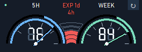

# Codex Usage Meter

主に**ChatGPT PlusでCodexを使うWindowsユーザー向け**の非公式ツールです。デスクトップに**5時間枠・週間枠の残量**と**Full Reset権**を小さく表示します。




## 表示

- 通常表示 **280×104px**、最小化すると常時数字が見える **104×43px** のガジェット。
- アナログの針と7セグ風数字。針の青／緑は各メーターに対応。
- **内側アーチ：残量**。左から増加。**外側アーチ：利用枠の経過時間**。右から増加。
- 中央は **5段×9色、最大45段階** のリセット権ゲージ。新しい色が下から前の色を上書きします。45回超の実数は詳細で確認できます。
- **EXP：現在利用可能なリセット権の最短失効までの日・時間**。5H／WEEKの回復時刻とは別です。0回、期限不明、取得失敗では表示しません。
- 起動時は針 **0→100→0**、中央 **0→20→0** が同時に往復し、最新値に着地。スイープ中の針は内外アーチの色の境目になります。
- 詳細はマウスオーバー。日本語の残り時間・回復日時・各権利の期限を表示。
- 半透明背景、最前面、ドラッグ移動、背景の濃さを変更できます。

画像はすべてダミーデータです。

## 対象プラン

主な対象・動作確認環境はChatGPT Plusです。2026-10-22に確認した[OpenAI公式の利用制限](https://learn.chatgpt.com/docs/pricing)では、Proに5時間枠はありません。このアプリは5H／WEEKの2枠がある利用形態を中心に設計しており、Proの実アカウントでの動作は未確認です。

プラン名から残量を推測せず、APIが返す枠の長さ（300分／10080分）で表示先を対応付けます。5時間枠がない場合、その枠は未取得の表示になり、週間枠の値を5Hへ流用しません。APIキーでの従量課金額を計測するツールではありません。対応状況はプラン・内部APIの変更に影響されます。

## Windowsで使う

1. [Releases](https://github.com/SecomaGeek/codex-usage-meter/releases) の `CodexUsageMeter-Windows-x64.zip` を取得します。
2. **フォルダー全体を展開**し、`CodexUsageMeter.exe` を起動します。`_internal`も必要です。
3. Codexにログイン済みであれば、既存のローカル認証から読み取りを行います。

リリースがまだない場合は、下の「ソースから起動・ビルド」を使えます。Pythonの別途インストールは配布版には不要です。対象はWindows 10/11 x64です。

| 操作 | 動作 |
| --- | --- |
| 右上の ↻ / Ctrl+R | 今すぐ更新 |
| 最小化 | 極小ガジェットへ |
| 極小をダブルクリック / Enter | 通常表示へ |
| 背景をドラッグ | 移動 |
| 右クリック | 更新・最前面・透明度・終了 |
| メーター／中央ゲージにホバー | 詳細 |

`CodexUsageMeter.exe --mini`で直接極小表示、`--demo`で認証情報やネットワークを使わず表示を試せます。

### Codexが見つからない場合

通常はCodex Desktopの同梱バイナリ、次にPATHの`codex`を探します。見つからない場合だけ環境変数 `CODEX_USAGE_METER_CODEX_EXE` に `codex.exe` の実際のパスを設定してください。特定バージョンのインストール先をハードコードしません。

`CODEX_HOME`が設定されている場合はその認証フォルダーを使い、未設定ならホームの`.codex`を使います。**auth.jsonやトークンを他人に渡す必要はありません。**

### 設定

`config.example.json`を `%APPDATA%\CodexUsageMeter\config.json` にコピーして変更します。

- `refresh_interval_seconds`：標準60秒。0で手動更新のみ。
- `show_startup_animation`：起動演出の有無。
- `prevent_multiple_instances`：二重起動防止。

毎秒の残り時間表示はローカル計算です。APIを毎秒呼びません。失効境界ではAPIの次回取得を待たずにゲージとEXPを更新します。

## ソースから起動・ビルド

Python **3.12以上（Tkinter同梱）** を使います。アプリ本体の外部依存はありません。

```powershell
python -m venv .venv
.\.venv\Scripts\python.exe -m pip install -e .
.\.venv\Scripts\python.exe -m codex_usage_meter --demo
.\.venv\Scripts\python.exe -m codex_usage_meter
```

テストはダミー権利・固定時計を使用し、権利を消費しません。

```powershell
.\.venv\Scripts\python.exe -m unittest discover -s tests -v
.\.venv\Scripts\python.exe tests/test_ui.py
```

公式Windows配布物のビルド（Python **3.13.5**）：

```powershell
.\.venv\Scripts\python.exe -m pip install -r requirements-build.txt
.\.venv\Scripts\python.exe -m pip install --no-build-isolation -e .
.\.venv\Scripts\python.exe scripts/build.py
```

`dist/CodexUsageMeter-Windows-x64.zip` を生成します。GitHub ActionsでもテストとWindowsビルドを実行できます。`v*`タグではテスト成功後にリリースを作成します。

## 読み取り範囲と認証

- 利用量：ローカル `codex app-server --stdio` の `account/rateLimits/read`。
- リセット権：`GET https://chatgpt.com/backend-api/wham/rate-limit-reset-credits`。
- ローカル認証をメモリー内で使用。トークンを表示・記録・送信先変更しません。API応答全文を保存しません。
- モデル呼び出し、プロンプト送信、会話の作成、リセット権の消費・実行機能はありません。

OpenAI公式の製品ではなく、提携・承認関係もありません。内部APIやログイン方式の変更で動作しなくなる場合があります。取得に失敗した値は正常0と区別して表示します。公開Issueには、認証ファイルや応答全文を貼らないでください。

## 開発について

元の個人用配布版からUIを発展させたものです。元ソースが残っていない取得・設定等の基盤部分は、所有者の確認のもと、配布版の観測した契約に合わせて読みやすいPythonソースとして再構成しました。このリポジトリは旧EXEや抽出バイトコードを必要としません。

現在の環境でソース起動・読み取り・通常／極小表示・Windowsビルドを検証済みです。OS自体の時刻変更、物理スリープ、別PCのDPI・フォント構成は網羅していません。時計・アカウント・期限境界のロジックは隔離テストで検証しています。

## ライセンス

本体は[MIT License](LICENSE)。Windows配布物に含まれるPython・Tcl/Tk・PyInstaller等の条件は [THIRD_PARTY_NOTICES.md](THIRD_PARTY_NOTICES.md) と配布物の `licenses/` を参照してください。
